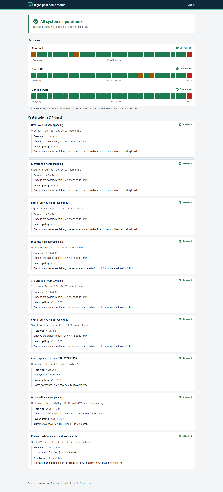
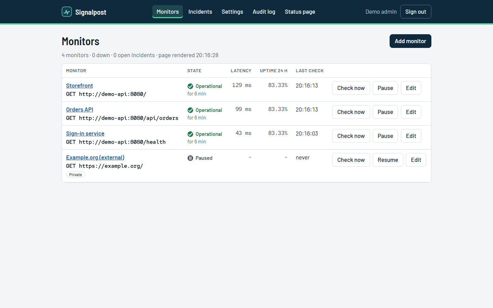
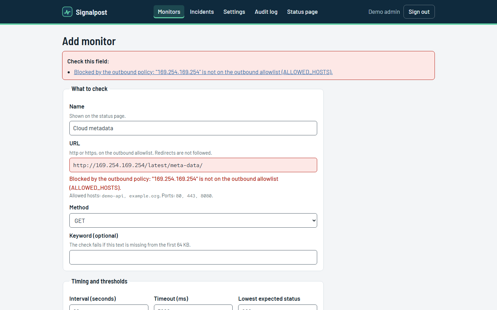
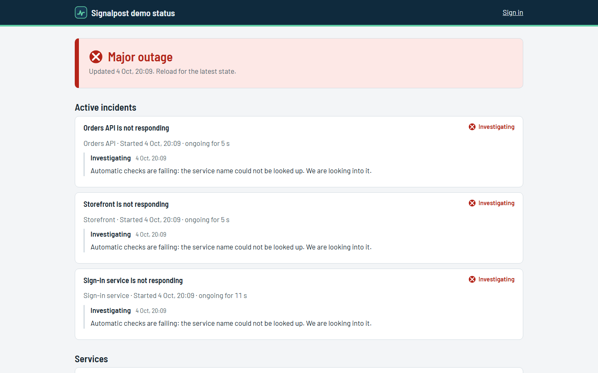

# Signalpost

Uptime monitoring with a public status page. Signalpost checks HTTP endpoints on a schedule, opens an incident
when a service fails repeatedly, resolves it when the service recovers, and shows it all on a status page.
The part that matters most is what it refuses to do: a monitoring tool makes requests on an administrator's
behalf, so every outbound request goes through an allowlist, DNS validation, address pinning and a
no-redirects rule. A monitor can never be pointed at cloud metadata, localhost or the internal network.



**Specialisation shown:** DevOps and network security: SSRF-safe outbound requests, incident automation,
metrics, health checks, retention, backups, hardened containers and a tested failure drill.

## What it does

- **Checks** HTTP and HTTPS endpoints (GET or HEAD) on an interval: expected status range, optional keyword in
  the first 64 KB, timeout, slow threshold.
- **Incidents** open automatically after N failed checks in a row and resolve after M good ones; admins post
  manual incidents and updates (outage, degraded, maintenance).
- **Status page** without JavaScript: overall state, 30 daily uptime bars per service, active and recent
  incidents. Names only; URLs and error details never leave the admin area.
- **Outbound policy**: host allowlist, port allowlist, DNS answers validated (loopback, link-local, metadata,
  private and reserved ranges refused), connection pinned to the validated address, redirects reported and not
  followed, body capped. Enforced when a monitor is saved and again on every check.
- **Operations**: `/healthz`, `/readyz`, Prometheus `/metrics` (off unless a token is set), signed incident
  webhooks (off unless configured), retention with daily rollups, online SQLite backups and verified restores,
  audit log, failure drill commands.

| Admin overview                                   | Policy refusal                                  | During a drill                                |
| ------------------------------------------------ | ----------------------------------------------- | --------------------------------------------- |
|  |  |  |

## Stack

TypeScript on Node.js 24, Fastify 5 with server-rendered HTML (no client scripts, CSP `script-src 'none'`),
SQLite through better-sqlite3 (WAL), ipaddr.js for address classification, Zod, Argon2id. Barlow, Barlow Semi
Condensed and Red Hat Mono served locally. Vitest, Playwright with axe-core. Distroless image, Docker Compose
with an internal-only network for the demo target, GitHub Actions.

## Quick start

```powershell
./scripts/ops.ps1 setup          # random .env, build, start, seed
```

Status page: **http://127.0.0.1:8105**. Admin: **http://127.0.0.1:8105/admin**, `admin@signalpost.test`,
password `SEED_ADMIN_PASSWORD` from the generated `.env`. Three demo monitors watch a stand-in service
(`demo-api`) that lives on an internal Docker network only.

```powershell
./scripts/ops.ps1 drill outage   # stop the demo service; incidents open within about a minute
./scripts/ops.ps1 drill recover  # start it again; incidents resolve after two good checks
./scripts/ops.ps1 drill slow | error | normal
./scripts/ops.ps1 start | stop | status | logs app | seed | backup | test | e2e
./scripts/ops.ps1 restore backups/<file>.db -Yes
./scripts/ops.ps1 reset-demo -Yes
```

## Tests

| Suite                                                                                  | Count | Command                    |
| -------------------------------------------------------------------------------------- | ----- | -------------------------- |
| Unit (address classes, policy rules, DNS answers, state machine, forms, HTML, metrics) | 64    | `npm run test:unit`        |
| Integration (real HTTP targets, outage lifecycle, webhooks, routes, CSRF, backups)     | 27    | `npm run test:integration` |
| E2E against the stack (desktop and phone, axe-core)                                    | 9     | `npm run test:e2e`         |
| CI only: failure drill, backup and restore on the running stack                        | 2     | `.github/workflows/ci.yml` |

## Documentation

[Architecture](docs/ARCHITECTURE.md) · [Decisions](docs/DECISIONS.md) · [Security and SSRF](docs/SECURITY.md) ·
[API, metrics, webhooks](docs/API.md) · [Setup](docs/SETUP.md) · [Testing](docs/TESTING.md) ·
[Operations](docs/OPERATIONS.md) · [Runbooks](docs/RUNBOOKS.md) · [Deployment](docs/DEPLOYMENT.md) ·
[Design](docs/DESIGN.md) · [Demo script](docs/DEMO.md) · [Exercises](docs/EXERCISES.md) ·
[Slim profile](docs/SLIM.md) · [Storage](docs/STORAGE.md) · [Changelog](CHANGELOG.md)

## Limitations

- HTTP and HTTPS checks only (no TCP, ICMP, DNS or certificate-expiry monitors).
- One process, one SQLite file: fine for hundreds of monitors, not a distributed checker. Checks come from
  one location, so a network problem near the checker looks like an outage.
- No notification channels beyond the signed webhook (no email or chat integrations).
- The earlier days of the demo's uptime bars and two past incidents are generated by the seed; they are
  flagged in the database and labelled on the page.

All names and services in the demo are fictional; the admin email uses the reserved `.test` domain. No licence
has been chosen for this code yet; font licences are listed in [docs/DESIGN.md](docs/DESIGN.md#assets-and-licences).
